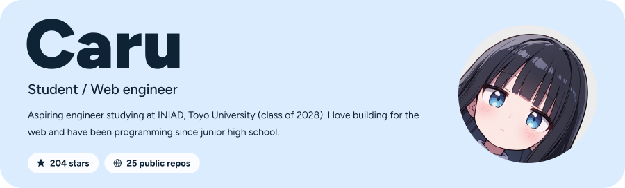
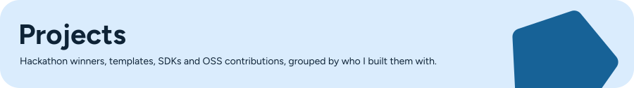
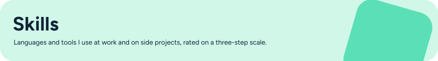
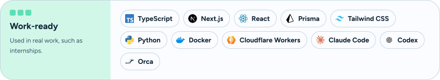
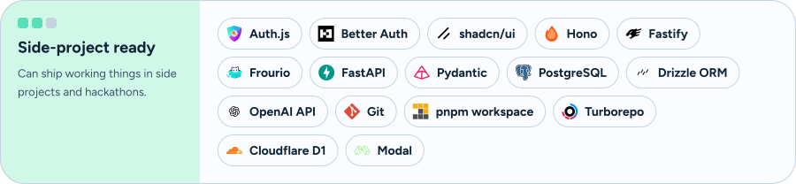
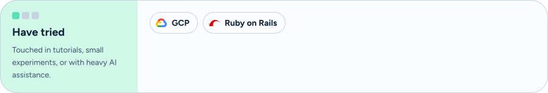
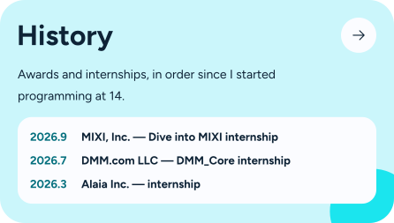
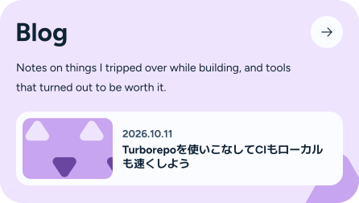

<a href="https://caru.moe/"><picture><source media="(prefers-color-scheme: dark)" srcset="assets/logo-dark.svg"></picture></a>

  <a href="https://caru.moe/"><picture><source media="(prefers-color-scheme: dark)" srcset="assets/btn-portfolio-dark.svg"></picture></a>
  <a href="https://runa.dev/"><picture><source media="(prefers-color-scheme: dark)" srcset="assets/btn-runa-dark.svg"></picture></a>
  <a href="https://caru.moe/blog"><picture><source media="(prefers-color-scheme: dark)" srcset="assets/btn-blog-dark.svg"></picture></a>
  <a href="https://zenn.dev/caru"><picture><source media="(prefers-color-scheme: dark)" srcset="assets/btn-zenn-dark.svg"></picture></a>

| Project | About | |
| :-- | :-- | :-- |
| **[Clothify](https://github.com/runa-devs/clothify)** · [runa.dev](https://runa.dev/) | Virtual try-on with image-generation AI (FLUX.1) · [demo](https://clothify.runa.dev/) |   |
| **[Yoncomic Studio](https://github.com/runa-devs/yoncomic-studio)** · [runa.dev](https://runa.dev/) | Four-panel comic maker; the art is drawn by image-generation AI |  |
| **[Magnito](https://github.com/frourios/magnito)** · [frourio](https://github.com/frourios) | Free, open Amazon Cognito emulator (OSS contribution) |  |
| **[discord-bot-template](https://github.com/caru-ini/discord-bot-template)** | AI-ready, type-safe Discord bot template with Bun, Biome and TypeScript |  |
| **[modal-comfyui](https://github.com/caru-ini/modal-comfyui)** | ComfyUI on Modal with auto-scaling, GPU snapshots and easy model management |  |
| **[NovelAI SDK](https://github.com/caru-ini/novelai-sdk)** | Type-safe Python SDK for the NovelAI API, validated with Pydantic v2 |  |
| **[Next.js Auth Template](https://github.com/caru-ini/next-authjs-template)** | Next.js 15 + Auth.js + Prisma + shadcn/ui starter kit |  |

  
  

  <a href="https://github.com/caru-ini"><picture><source media="(prefers-color-scheme: dark)" srcset="assets/link-github-dark.svg"></picture></a>
  <a href="https://x.com/caru_ini"><picture><source media="(prefers-color-scheme: dark)" srcset="assets/link-x-dark.svg"></picture></a>
  <a href="https://discord.com/users/1226826654794649690"><picture><source media="(prefers-color-scheme: dark)" srcset="assets/link-discord-dark.svg"></picture></a>
  <a href="mailto:caru17122@gmail.com"><picture><source media="(prefers-color-scheme: dark)" srcset="assets/link-mail-dark.svg"></picture></a>

  
Discord presence

  

